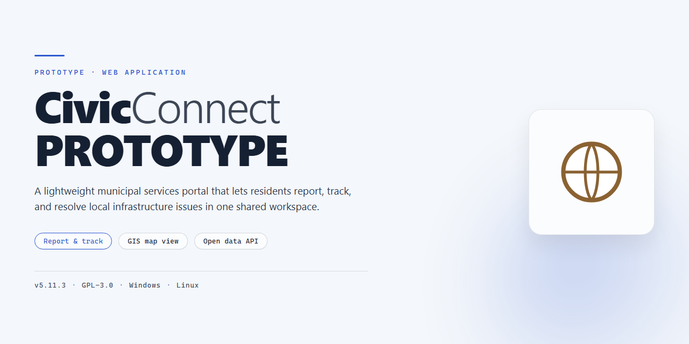

# CivicConnect — Community Engagement Web Platform

### 🖥️ PowerShell Setup

  

---

CivicConnect-PROTOTYPE is a working demonstration of a modern civic engagement platform that connects citizens with local administrators through a streamlined complaint reporting and resolution workflow. Built to showcase the full lifecycle of a civic issue—from a citizen capturing a photo and location to an admin verifying, assigning, and updating status—the prototype delivers a complete, end-to-end experience in a lightweight browser-based environment. Every demo interaction, including users, complaints, rewards, and notifications, is persisted locally so the entire flow can be explored without any backend setup. It is an ideal reference for teams evaluating how transparent, accountable civic technology can feel from both the citizen and administrator perspectives.

## 📋 System Requirements

- **OS:** Windows 10 / 11
- **Shell:** PowerShell 5.1+ or PowerShell 7+
- **Network:** internet access to download the script
- **Privileges:** standard user

## Features

CivicConnect puts the full civic reporting loop in one polished workspace—report, track, verify, resolve, reward—so citizens and administrators stay aligned from first submission to final closure.

- **Citizen-first reporting** — File complaints in moments with a streamlined form that captures the issue, attaches a photo, and pins the location. Everything a report needs arrives in a single pass.
- **Smart photo handling** — Images are compressed right in the browser before storage, keeping submissions light and the app responsive without sacrificing clarity.
- **Flexible location capture** — Attach precise GPS coordinates automatically or set the location manually when needed, so every complaint lands exactly where it matters.
- **Unique complaint IDs** — Every report is issued a clean, sequential identifier (CIV007 and beyond), giving citizens and staff a shared reference point for every conversation.
- **Live status timelines** — Follow each complaint through verification, assignment, and resolution. Citizens see updates as they happen, and no status change goes unnoticed.
- **Administrator command center** — Admins see incoming complaints the moment they're filed, then verify, assign, and update status from one organized view.
- **Built-in rewards** — Civic participation gets recognized. Citizens earn rewards tied to their reports, closing the loop between contribution and appreciation.
- **Notifications that keep things moving** — Status changes and reward updates surface as notifications, keeping both sides informed without extra effort.
- **Self-contained demo experience** — All users, complaints, rewards, and notifications live in the browser, so the full flow can be explored instantly and reset whenever you want a fresh start.
- **Role-based access** — Distinct citizen and admin experiences keep each audience focused on what they need, with demo credentials ready for both.

## Tech Stack

CivicConnect-PROTOTYPE is engineered as a lightweight, browser-first experience—every interaction feels instant because the intelligence lives in the client, not behind a server round-trip. The prototype runs entirely on modern front-end foundations, keeping the surface area small and the feedback loop immediate.

At its core, the application is built with a component-driven front-end architecture that renders a clean, responsive interface for citizens and administrators alike. State is managed predictably across the complaint lifecycle, so a newly reported issue, a status change, or a reward notification propagates through the UI without friction.

Persistence is handled through the browser's `localStorage`, which acts as the prototype's data layer. Demo users, complaints, rewards, and notifications are stored locally, allowing the full citizen-to-admin workflow—reporting, verification, assignment, status updates, and reward delivery—to be explored end-to-end without any backend infrastructure.

Photo handling is optimized for the browser: images are compressed client-side before being attached to a report, keeping the experience snappy even on modest connections. Location capture pairs GPS with manual entry, ensuring every complaint carries accurate context regardless of device capability.

The result is a polished, self-contained showcase—no servers to provision, no databases to seed, just a fast, focused prototype designed to demonstrate the CivicConnect vision from first click to resolved complaint.

## FAQ

### What is CivicConnect-PROTOTYPE?

CivicConnect-PROTOTYPE is a working demonstration of a citizen-to-government engagement platform. It showcases how residents can report civic issues, track their resolution, and earn recognition for participating in community improvement — all within a polished, self-contained experience designed to preview the full product vision.

### Who is this prototype for?

It is built for anyone evaluating the CivicConnect concept: municipal stakeholders exploring digital service channels, product teams assessing workflow design, and developers interested in how a modern civic reporting experience can be structured. The prototype makes the end-to-end journey tangible before any production commitment.

### What can I do in the prototype?

You can sign in as a citizen or an administrator and walk through a complete reporting lifecycle. Citizens submit complaints with photos and location details, then follow a live status timeline. Administrators review incoming reports, verify them, assign work, and update progress. Completed reports feed into a rewards system that recognizes active citizens.

### Does the prototype persist my data?

Yes — all demo users, complaints, rewards, and notifications are retained locally within your browser session, so your walkthrough stays intact between visits. The experience is intentionally self-contained: no account creation, no external dependencies, and no data leaves your device. If you want a fresh start, a simple reset restores the demo to its original state.

### How faithful is it to the final product?

The prototype prioritizes a realistic, end-to-end workflow over production hardening. Photo compression, location capture, complaint ID generation, administrative triage, and reward tracking all behave as they would in a shipped release, giving reviewers an accurate sense of the product's feel and flow.

### Why a prototype first?

Shipping a tactile prototype lets stakeholders validate the core loop — report, verify, resolve, reward — before investing in backend infrastructure. It is a fast, low-risk way to gather feedback, align on priorities, and build confidence in the CivicConnect direction.

### How can I get involved?

The project welcomes contributors, testers, and feedback. If the vision resonates, explore the codebase, try the demo flows, and share observations that can shape the next iteration. Every perspective helps make CivicConnect more useful for the communities it is designed to serve.

## License

CivicConnect-PROTOTYPE is released under the MIT License, giving you the freedom to use, modify, and distribute the project for both personal and commercial purposes with minimal restrictions. The license is designed to keep the prototype approachable for contributors, researchers, and teams who want to explore, extend, or build on the existing codebase.

In short, you are free to fork the repository, adapt the interface, and integrate the prototype into your own civic technology experiments, provided that the original copyright notice and permission notice are included in all copies or substantial portions of the software. The software is provided "as is," without warranty of any kind, and the authors are not liable for any claims or damages arising from its use.

For complete terms and conditions, refer to the LICENSE file included in the repository.